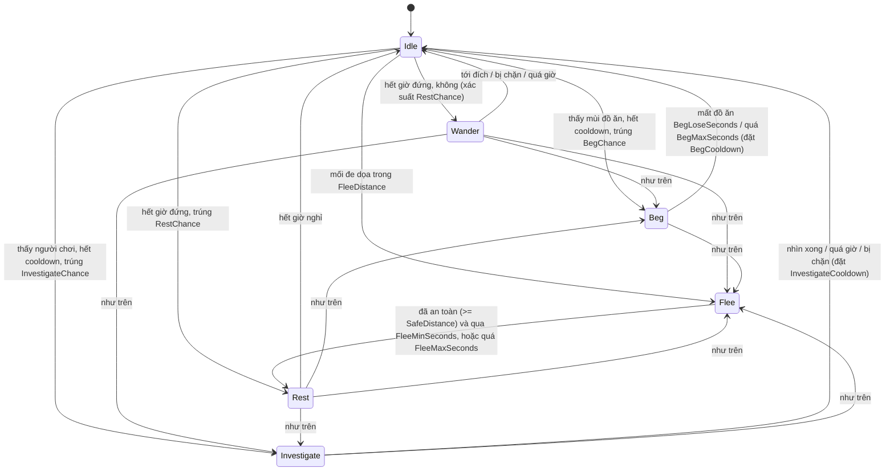

# AI động vật phố (chó, mèo, gà, bồ câu) — tài liệu vấn đáp

Mục "Cơ chế AI trong Unity 3D" (bài 8) của môn Phát triển ứng dụng Game nâng cao.
Trạng thái: **đã viết, CHƯA biên dịch, CHƯA chạy trong Unity, CHƯA chạy test**. Mọi chỗ ghi "chưa kiểm chứng" ở cuối tài liệu.

## 1. AI trong game này là gì

"AI" ở đây là hành vi của con vật tự quyết định, gồm ba lớp tách riêng, mỗi lớp giải thích được độc lập:

| Lớp | Câu hỏi nó trả lời | Kỹ thuật | Lớp C# |
|---|---|---|---|
| Cảm nhận (perception) | Con vật biết gì về thế giới? | Tầm nhìn hình nón (khoảng cách + góc), Raycast che khuất, tầm nghe, mùi | `AnimalPerception`, `VisionCone`, `PhysicsLineOfSight` |
| Quyết định | Con vật muốn làm gì? | Máy trạng thái hữu hạn (FSM), thời gian hồi (cooldown), ngẫu nhiên có hạt giống | `AnimalBrain`, `AnimalProfile` |
| Chuyển động | Đi tới đó thế nào? | A* trên đồ thị điểm + bám đường + tránh người/xe (steering) | `AnimalRoute`, `WaypointGraph`, `PathFollower`, `SeparationSteering` |

Luồng mỗi lần "nghĩ": `Sense()` -> `AnimalSenses` -> `AnimalBrain.Update()` -> (trạng thái, đích, tốc độ) -> `AnimalRoute.Build()` -> `PathFollower.Step()`.
Bộ não **không di chuyển gì cả**; nó chỉ trả lời "đang ở trạng thái nào, muốn đi đâu". Nhờ vậy test được bằng NUnit mà không cần cảnh Unity.

## 2. Sơ đồ trạng thái (FSM)



| Trạng thái | Làm gì | Vào khi | Ra khi |
|---|---|---|---|
| Idle | Đứng yên 1,5–5,5 s (ngẫu nhiên) | Mặc định, sau mọi trạng thái | Hết giờ -> Wander hoặc Rest; hoặc bị ngắt bởi Beg/Investigate/Flee |
| Wander | Đi tới điểm ngẫu nhiên trong vòng tròn quanh chỗ đặt (dùng `WanderArea.Pick`) | Hết giờ Idle | Tới nơi, bị chặn, quá giờ |
| Investigate | Đi về phía người chơi, dừng cách `InvestigateStopDistance`, nhìn | Thấy người chơi trong hình nón (không đủ gần để sợ) | Nhìn đủ `InvestigateLookSeconds`, quá giờ |
| Beg | Đi tới cạnh bàn có người ăn, rồi ngồi, quay mặt về đồ ăn | Ngửi thấy mùi trong `SmellRange` | Mất đồ ăn 3 s, quá 25 s |
| Flee | Chạy (tốc độ x`RunMultiplier`) ngược hướng mối đe dọa, không xa quá `FleeLeash` khỏi nhà | Người chơi hoặc xe máy trong `FleeDistance` | An toàn, hoặc quá giờ |
| Rest | Ngồi/nằm 6–14 s | Sau Flee, hoặc trúng `RestChance` từ Idle | Hết giờ |

Quy tắc ưu tiên: **Flee là phản xạ**, đứng đầu mọi điều kiện (kiểm tra trước `switch`). Sau Flee, cooldown của Beg (một nửa) và Investigate được đặt để con vật không quay lại ngay chỗ vừa chạy khỏi.

Ngẫu nhiên: một `System.Random(seed)` duy nhất cho mỗi con. Xác suất Beg/Investigate chỉ tung xúc xắc tối đa mỗi `DecisionInterval` (2 s), nên không phụ thuộc tốc độ khung hình. Cùng seed + cùng chuỗi cảm nhận = cùng hành vi (có test).

Hệ số theo loài (`AnimalProfile.For`): chó gan (FleeDistance 1,5 m), tò mò và hay xin; mèo nhát (2,8 m), chạy nhanh, hay nghỉ; gà tầm nhìn rộng 200 độ; bồ câu không tò mò. Đây chỉ là số tinh chỉnh hành vi, không phải món/giá/thương hiệu.

## 3. Cảm nhận

- **Nhìn**: `VisionCone.Contains(origin, forward, target, distance, halfAngle)` trên mặt phẳng ngang. Sau đó `ILineOfSight.IsBlocked` (Unity: `PhysicsLineOfSight` = `Physics.RaycastNonAlloc` trên layer Environment, bỏ qua collider của chính các con vật).
- **Nghe**: chỉ cần khoảng cách. Mỗi mối đe dọa có `Danger` (người = 1, xe máy = lớn hơn): khoảng cách hiệu dụng = khoảng cách / Danger, nên xe máy bị nghe và gây sợ từ xa hơn, và xuyên tường vẫn nghe thấy.
- **Ngửi**: `IAnimalFoodSource.TryFindFood` theo khoảng cách, không cần hướng nhìn.
- Người chơi chỉ gây **tò mò** khi được *nhìn thấy* (không phải chỉ nghe).
- Thay bằng dữ liệu giả: `IAnimalPerception` (test dùng `ScriptedPerception`), hoặc `StreetAnimalWander.SetPerception(fake)` trong cảnh.

## 4. Chuyển động

1. Bộ não đưa ra `Destination` (kèm `DestinationId` tăng dần).
2. `AnimalRoute.Build`: đi < 3 m thì đi thẳng; xa hơn thì lấy nút gần nhất ở làn vỉa hè (`SidewalkNorth/South`) của `WaypointGraph`, chạy `TryFindPath` (A* với `MinHeap` hàng đợi ưu tiên), nối với điểm xuất phát và đích. Quay về đường thẳng nếu không có nút trong 5 m, không có đường, hoặc đường vòng dài hơn 3 lần.
3. `PathFollower` đi dọc đường theo đồng hồ game (dừng game thì con vật đứng).
4. **Steering tránh va chạm**: `SeparationSteering.Push` tính lực đẩy ra khỏi người chơi, xe, con vật khác trong bán kính tách (0,8 m); lực này tạo một độ lệch ngang (tối đa 0,6 m) rồi tự tan dần, nên con vật né sang bên nhưng vẫn bám tuyến. Feeler raycast phía trước; gặp tường thì `ReportBlocked`.
5. **Hoạt ảnh**: prefab chó/mèo/gà/bồ câu hiện **không có Animator** (grep `Animator` trong prefab = 0). Vì vậy chỉ dịch chuyển, xoay mượt và nhún nhẹ. Nếu sau này có Animator Controller, code đặt `Speed` (float) và `Sitting` (bool) — hai tham số `PersonView` đang đọc — và **chỉ khi controller khai báo chúng**.

## 5. Hiệu năng (LOD cho AI)

`AnimalLod` chia theo khoảng cách tới người chơi (hoặc camera chính nếu chưa nối người chơi):

| Tầng | Khoảng cách | Nghĩ (cảm nhận + FSM) | Di chuyển |
|---|---|---|---|
| Near | <= 12 m | 0,1 s | mỗi khung hình |
| Mid | <= 30 m | 0,3 s | 0,1 s |
| Far | <= 60 m | 1 s | 0,4 s |
| Dormant | > 60 m | 2 s | 1 s |

Phải có vài chục con, hầu hết ở tầng Far/Dormant. Cảm nhận không cấp phát bộ nhớ (danh sách dùng lại, `RaycastNonAlloc`). Chữ nổi chỉ hiện ở Near/Mid.

## 6. Demo

1. Chọn một con vật trong Hierarchy khi đang Play: **Gizmos** (`OnDrawGizmosSelected`) vẽ hình nón nhìn (vàng), bán kính nghe (xanh lam), bán kính sợ (đỏ), đường đi (xanh lá), đích, và nhãn Handles gồm loài, trạng thái, tầng LOD, cooldown.
2. Chữ nổi trên đầu mọi con: bật `StreetAnimalContext.ShowStateLabels = true`, hoặc tích `Show Debug Label` trên từng `StreetAnimalWander`.
3. Kịch bản nói: (a) đứng xa, con vật Idle/Wander; (b) đi tới từ phía trước: nó chuyển Investigate; (c) lao lại gần: Flee rồi Rest; (d) có người ăn ở bàn: Beg (cần nối nguồn đồ ăn, mục 8); (e) chạy xe máy lại gần: Flee (cần nối nguồn xe, mục 8).
4. Test chạy: Test Runner -> EditMode -> `AnimalBrainTests`, `AnimalPerceptionTests`, `AnimalMovementTests`.

## 7. So sánh với NavMeshAgent

| Tiêu chí | Đồ thị điểm + A* + FSM (game này) | NavMeshAgent |
|---|---|---|
| Chuẩn bị | Không cần bake; đồ thị dựng lúc chạy từ các neo `WP_*` | Phải bake NavMesh, và bake lại khi phố sinh lúc chạy (cần gói `NavMeshSurface`) |
| Phố sinh lúc chạy | Phù hợp: chỉ thêm nút/cạnh | Khó: phải bake lúc chạy, tốn |
| Kiểm thử | Thuần C#, test NUnit không cần Unity | Cần cảnh và NavMesh thật, khó test lặp lại |
| Xác định (deterministic) | Có: cùng đầu vào, cùng đường (hòa thì chọn nút chỉ số nhỏ) | Phụ thuộc nội bộ Unity |
| Phụ thuộc thêm | Không có gói mới (`Packages/` không đổi) | Cần module AI Navigation |
| Độ chính xác bề mặt | Thô: chỉ đi qua các nút, đi thẳng giữa nút | Tốt: đi tự do trên mặt phẳng, né vật cản tự động, gồm cả `NavMeshObstacle` |
| Né vật cản động | Tự làm bằng steering tách | Có sẵn (avoidance của agent) |
| Địa hình phức tạp, nhiều tầng | Kém | Tốt |
| Số lượng lớn | Rẻ nếu ít nút; tự làm LOD | Tốt, nhưng agent cũng tốn CPU |

**Vì sao không dùng NavMesh**: chủ quán đã chọn như vậy vì phố sinh lúc chạy (không có bake sẵn), đồ thị đã tồn tại cho người và xe nên dùng lại, không thêm gói, và cần test được không cần Unity. Đổi lại phải chấp nhận đi tuyến thô; vì vậy chuyển động quanh quầy dùng đường thẳng ngắn có raycast tránh tường.

## 8. Tệp và lớp

| Tệp | Lớp | Ghi chú |
|---|---|---|
| `Scripts/People/AnimalBrain.cs` | `AnimalBrain` | FSM thuần C# |
| `Scripts/People/AnimalState.cs`, `AnimalSpecies.cs`, `AnimalProfile.cs` | enum, enum, hồ sơ loài | Số liệu hành vi |
| `Scripts/People/AnimalSenses.cs`, `AnimalThreat.cs` | dữ liệu cảm nhận | Đầu vào của FSM |
| `Scripts/People/AnimalPerception.cs`, `VisionCone.cs`, `IAnimalPerception.cs`, `IAnimalThreatSource.cs`, `IAnimalFoodSource.cs`, `ILineOfSight.cs` | cảm nhận + giao diện thay được | |
| `Scripts/People/AnimalRoute.cs`, `SeparationSteering.cs` | đường đi, tránh va chạm | Dùng `WaypointGraph`, `PathFollower` có sẵn |
| `Scripts/People/AnimalLod.cs`, `AnimalLodTier.cs` | LOD | |
| `Scripts/Core/Bootstrap/StreetAnimalWander.cs` | `StreetAnimalWander` | View mỏng; giữ tên cũ nên bootstrap/scene không đổi |
| `Scripts/Core/Bootstrap/People/StreetAnimalContext.cs`, `PhysicsLineOfSight.cs` | dữ liệu chung, raycast | |
| `Tests/EditMode/People/Animal*Tests.cs` | test | |

## 9. Nối với phần còn lại của game (việc của lead)

Không sửa `TramChanhMainBootstrap`. `StreetAnimalWander.Configure(radius, speed, seed)` và `Tick(seconds)` giữ nguyên chữ ký, nên bootstrap hiện tại vẫn chạy: con vật nhìn camera chính như người chơi, đi thẳng, chưa xin ăn, chưa sợ xe máy. Để bật đầy đủ, thêm vào `SetUpStreetAnimals` (sau khi `People.Prepare`):

```csharp
var ctx = new StreetAnimalContext { Graph = People.Graph, Player = _player.transform, Food = /* IAnimalFoodSource, xem dưới */ };
// trong vòng lặp tạo: wander.Bind(ctx);
```

- `Food`: lead cài `IAnimalFoodSource` trả về vị trí bàn đang có khách ăn có đồ (dữ liệu có sẵn trong `CustomerDirector`/Lobby; AI không phụ thuộc ngược assembly).
- `VehicleThreats`: `Action<List<AnimalThreat>>` thêm `new AnimalThreat(vị trí xe, 2f, false)` cho mỗi xe máy (`PeopleController` hiện giữ xe ở trường private).
- Bồ câu: bootstrap chỉ khớp tiền tố `PF_Street_Dog/Cat/Chicken`, nên `PF_Street_Pigeon` chưa có AI; thêm một nhánh `else if (n.StartsWith("PF_Street_Pigeon"))` nếu muốn.

## 10. Chưa kiểm chứng

- Chưa mở Unity, chưa biên dịch, chưa chạy EditMode/PlayMode; test chỉ được viết, chưa có kết quả.
- Chữ nổi dùng `TextMesh` với font `LegacyRuntime.ttf` và vật liệu của font: chưa biết có hiển thị đúng trong URP.
- Giá trị tinh chỉnh (khoảng cách, thời gian, xác suất) là ước lượng, cần chơi thử.
- Đường đi chỉ qua làn vỉa hè; chưa kiểm tra đồ thị thật có nối chéo qua đường hay không.
- Chưa kiểm hiệu năng bằng Profiler với vài chục con.
